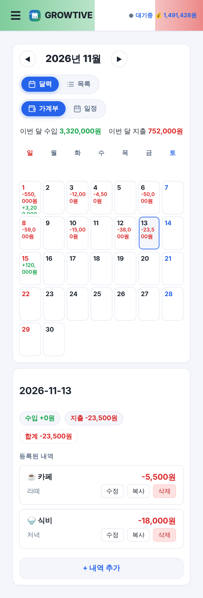
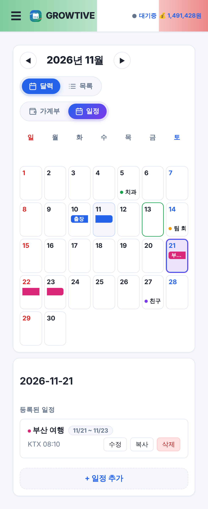
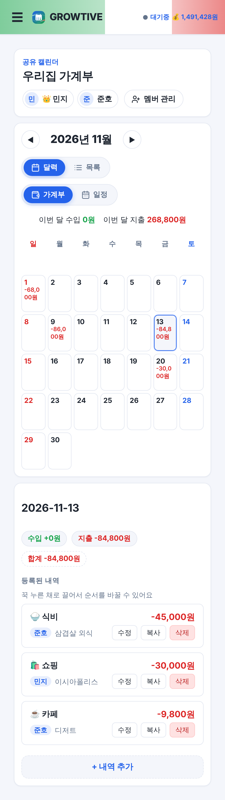
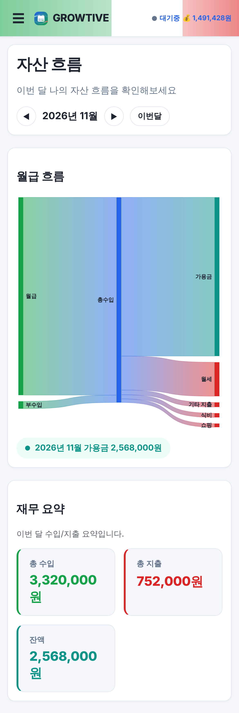
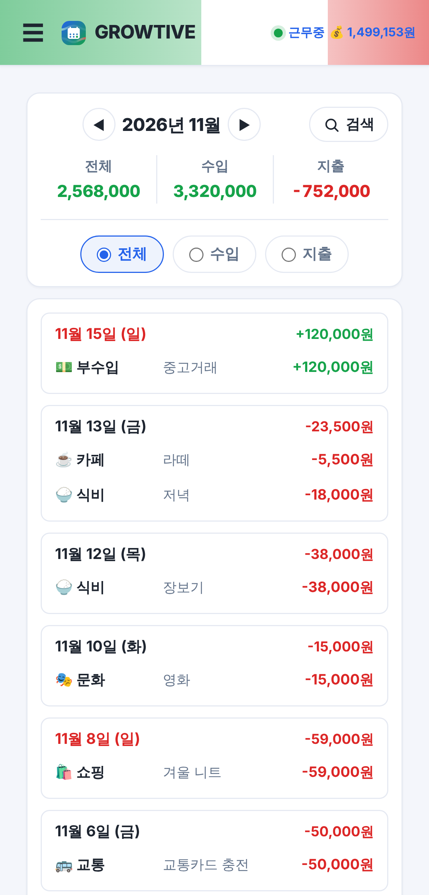

# GrowTive (그로우티브)

가계부와 일정을 한 곳에서, 가족·친구와 함께 관리하는 개인 재무·캘린더 서비스입니다.

**🔗 바로 써보기: [growtive.onrender.com](https://growtive.onrender.com)**

---

## Screenshots

| 가계부 캘린더 | 일정 캘린더 | 공유 캘린더 |
|:---:|:---:|:---:|
|  |  |  |

| 자산 흐름 | 자산 내역 | 복사 |
|:---:|:---:|:---:|
|  |  |  |

> 스크린샷은 테스트용 가짜 데이터로 찍었습니다.

## Features

- ⏱️ **실시간 급여·지출 게이지** — 상단바에서 이번 기간 돈 상황을 한눈에. 시작일 규칙(매달 N일·말일·N번째 X요일, 주말·공휴일이면 전/다음 평일)과 금액(고정 금액 — 시작일마다 가계부 자동 기록 / 한 달 예산) 설정, 직장인은 근무 시간에 따라 쌓이는 게이지, 학생·예산 관리는 남은 돈 · 하루 쓸 수 있는 돈 · D-day
- 📅 **가계부 캘린더** — 매일 수입/지출을 달력에 바로 기록, 매달 반복되는 월급·월세는 자동 등록
- 🗓️ **일정 캘린더** — 같은 화면에서 [가계부]/[일정] 전환, 기간/시간/색상 지정, 달력·목록 두 가지 보기
- 👨‍👩‍👧 **공유 캘린더** — 가족·연인과 가계부·일정을 함께 쓰는 캘린더. 초대·수락, 작성자 표시, 💸 정산(달력에서 고른 날짜의 지출을 똑같이 나눠 누가 누구에게 얼마), 꾹 눌러 순서 바꾸기, 👑 관리자(멤버 관리·이름 변경·삭제·권한 넘기기), 나가기, 개인 통계와 분리
- 📈 **자산 흐름** — 흐름(Sankey) 차트로 이번 달 수입 → 지출을 시각화, 총수입·총지출·잔액 요약
- 🧾 **자산 내역** — 날짜별 한 줄 목록(누르면 수정·삭제), 전체/수입/지출 보기, 검색(기간: 전체·연별·월별·주별·직접 입력 / 카테고리 / 메모), 📌 기본 기간 핀(기기 간 유지), 📥 엑셀(CSV)로 저장
- 👫 **친구** — 아이디·닉네임으로 친구를 찾아 연결하고, 친구와 바로 공유 캘린더 만들기
- 📋 **복사** — 가계부 내역·일정을 내 캘린더/공유 캘린더 여러 곳에 원하는 날짜로 복사
- 🙂 **닉네임** — 다른 사람에게는 실명 대신 닉네임 표시, 마이페이지에서 변경
- 📲 **홈 화면 설치(PWA)** — 모바일에서 앱처럼 설치해 전체 화면으로 실행
- 💬 **카카오 소셜 로그인** — 카카오 계정으로 바로 로그인, 기존 계정에 연결도 가능
- 📱 **모바일 최적화** — 반응형 레이아웃, 접이식 사이드바, 터치 드래그로 일정 기간 선택
- 🌙 다크 모드 지원

---

## Tech Stack

**Backend**: Spring Boot 3, Spring Security (Session + OAuth2 Client), MyBatis, MariaDB/MySQL

**Frontend**: Vanilla JS SPA (hash 라우팅, 별도 프레임워크 없음), Axios, Chart.js + chartjs-chart-sankey

**Infra**: Render(무료 티어) + Aiven MySQL(무료 티어), GitHub Actions로 콜드 슬립 방지, GitHub push 시 자동 배포

---

## Architecture

```
Page (SPA) → Axios → Spring Controller → Service → MyBatis → MariaDB
```

- 세션 기반 인증(HttpSession), 카카오 로그인은 Spring Security OAuth2 Client로 연동 후 동일한 세션 체계에 편입
- 가계부/일정은 `daily_transaction` / `schedule_event` 단일 테이블 기반, 반복 항목은 origin-occurrence 방식으로 자동 생성
- 공유 캘린더는 `shared_calendar` / 멤버 테이블 기반, 친구 연결(`friend_connection`)로 초대

---

## Commit Convention

This project follows the Conventional Commit format.

```
feat: add login API
fix: login session bug
refactor: auth service
docs: update README
```

| Type | Description |
|-----|-------------|
| feat | 새로운 기능 |
| fix | 버그 수정 |
| refactor | 코드 구조 개선 |
| docs | 문서 수정 |
| style | 코드 스타일 변경 |
| chore | 빌드/설정 변경 |
